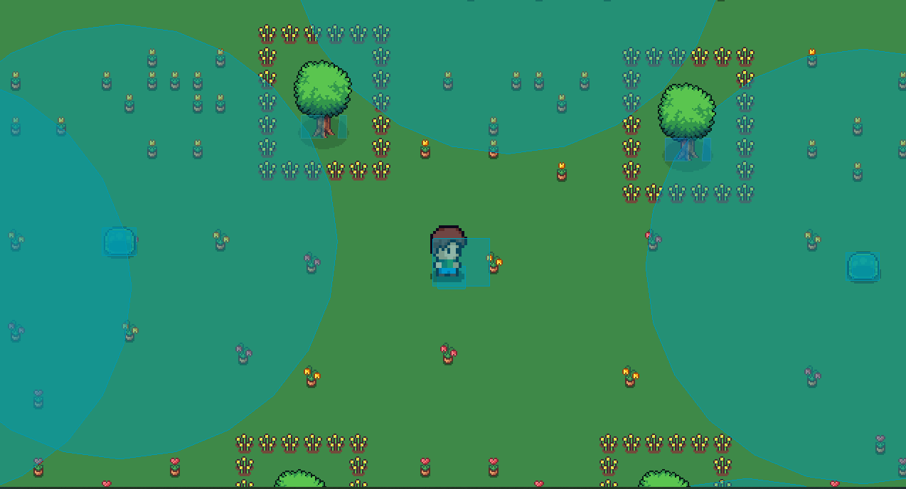

# TopDown
A 2D top-down adventure game with 4 levels, each getting harder as you progress. The player carries a sword to fight slimes and that attack along the way. The goal is to survive all four levels and reach the final destination. You start with 5 hearts, each divided into two halves. Every enemy attack takes away half a heart, so you must dodge attacks, fight wisely, and manage your health carefully. Can you survive all four levels and make it to the end?
You can play my game right now using the link [here](https://h-buktar.itch.io/topdown).
Here is a Screenshot of the game!


## HOW THIS WAS MADE
I made this using Godot 4.7.2 and wrote scripts using GDScript

## heres how to run the project :)
Clone the source code to your device
```sh
git clone https://github.com/h-buktar/topdown.git
```
and be joyous!

## Controls for the game

Spacebar => Attack
Left/Right/Up/Down Arrow Keys => Player Movement
